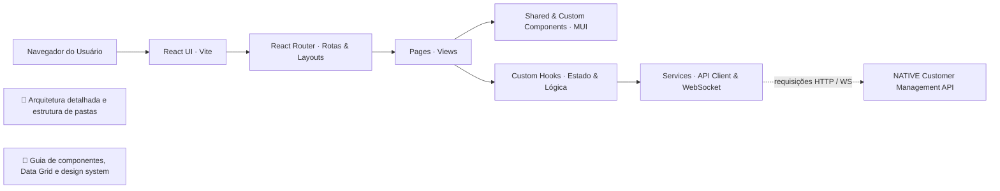
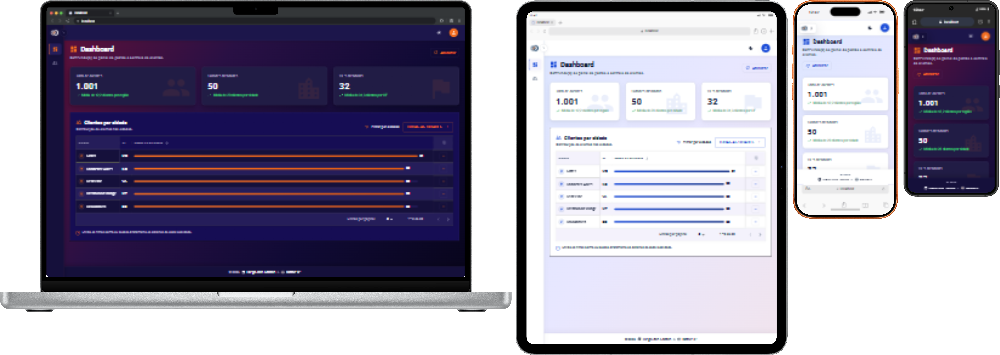

# NATIVE - Customer Management UI

Interface Web Front-end desenvolvida em React 19 com TypeScript, Vite e SCSS, estruturada sob os princípios de **Clean Architecture**, **Componentização Reutilizável** e **Design System Customizado** para a gestão de clientes e atendimento da Native IP.

---

## 🛠️ Stack Tecnológica

- **Core / Runtime:** Node.js v26.5.0 (gerenciado via `.nvmrc`)
- **Linguagem:** TypeScript
- **Framework / Build Tool:** React 19 + Vite (Porta `4200`)
- **UI Framework / Design System:** Material Design (MUI v6) com centralização em `src/components/common/mui`
- **Estilização & Temas:** SCSS centralizado em `src/assets/styles/_variables.scss` (suporte a Dark/Light mode via atributos `[data-theme]`) + Emotion
- **Roteamento:** React Router DOM (v7) com Code Splitting (`React.lazy` + `Suspense`)
- **Comunicação Real-time:** Socket.io-client
- **Testes & Qualidade:** Vitest + ESLint v9 + Prettier + Madge (verificação de dependências circulares)

---

## 🧭 Visão Geral da Arquitetura

Este diagrama resume o fluxo principal da UI e conecta a documentação detalhada das camadas e componentes.



> - [📐 Arquitetura detalhada, camadas e estrutura de pastas](docs/architecture.md)
> - [🧩 Guia de componentes, Data Grid otimizado e galeria de telas](docs/components.md)

---

## 🖼️ Prévia da Aplicação

Abaixo está a visualização multi-dispositivo da aplicação, demonstrando a responsividade e adaptação do tema em diferentes resoluções.

### 📱 Visão Geral Multi-dispositivo (Dark & Light Mode)



> Veja a [Galeria Completa de Capturas de Tela](docs/components.md#galeria-de-telas) no guia de componentes para explorar todas as visões de páginas, menus e estados da interface.

---

## 🚀 Pré-requisitos e Gestão de Versão (NVM & Node.js)

Para manter a consistência do ambiente entre os desenvolvedores e no pipeline de CI/CD, o projeto padroniza a versão do Node.js.

- **Node.js:** `v26.5.0` (definido no arquivo `.nvmrc`)
- **NPM:** `v10.x` ou superior
- **NVM (Node Version Manager):** recomendado para alternar entre versões do Node.js.

### Como instalar o NVM

[NVM Download](https://www.nvmnode.com/pt/guide/download.html)

### Como alternar para a versão correta do Node via NVM

**Linux / macOS / WSL:**

```bash
nvm use
```

**Windows (`nvm-windows`):**

```cmd
nvm use 26.5.0
```

---

## ⚙️ Configuração do Ambiente

1. **Clonar o repositório e acessar a pasta da UI:**

   ```bash
   git clone https://github.com/DiegoSantos18/NATIVE.CustomerManagement.UI.git
   cd NATIVE.CustomerManagement.UI
   ```

2. **Selecionar a versão do Node.js definida pelo projeto:**

   ```bash
   nvm use
   ```

3. **Instalar as dependências:**

   ```bash
   npm install
   ```

4. **Configurar as variáveis de ambiente:**

   Copie `.env.example` para `.env` e ajuste os valores locais conforme necessário:

   ```bash
   cp .env.example .env
   ```

   No Windows PowerShell, você também pode usar:

   ```powershell
   if (!(Test-Path .env)) { Copy-Item .env.example .env }
   ```

---

## 📜 Scripts Disponíveis

| Comando                  | Descrição                                                             |
| ------------------------ | --------------------------------------------------------------------- |
| `npm run dev`            | Inicia o servidor de desenvolvimento na porta `4200` com HMR do Vite. |
| `npm run build`          | Compila o TypeScript e gera o bundle minificado na pasta `dist/`.     |
| `npm run preview`        | Executa a versão de produção compilada localmente para verificação.   |
| `npm run test`           | Executa a suíte de testes unitários com o Vitest.                     |
| `npm run lint`           | Executa a verificação estática do código com ESLint v9.               |
| `npm run lint:fix`       | Corrige automaticamente problemas identificados pelo ESLint.          |
| `npm run format`         | Formata o código nos diretórios do projeto utilizando o Prettier.     |
| `npm run format:check`   | Verifica a formatação do código via Prettier.                         |
| `npm run check:circular` | Verifica dependências circulares no código-fonte com Madge.           |
| `npm run check:all`      | Executa verificações completas (Prettier, ESLint, Madge e Build).     |

---

## 🏃 Como Executar a Aplicação

### Modo Desenvolvimento

Para subir o front-end localmente conectando à API:

```bash
npm run dev
```

O front-end estará acessível em: `http://localhost:4200`

---

## 🌐 Mapeamento de Portas do Ecossistema

| Serviço                 | URL                     | Descrição              |
| ----------------------- | ----------------------- | ---------------------- |
| **Front-end (UI)**      | `http://localhost:4200` | Aplicação React + Vite |
| **Back-end (API REST)** | `http://localhost:3000` | API Express / Node.js  |
| **WebSocket**           | `http://localhost:3000` | Socket.io Server       |
