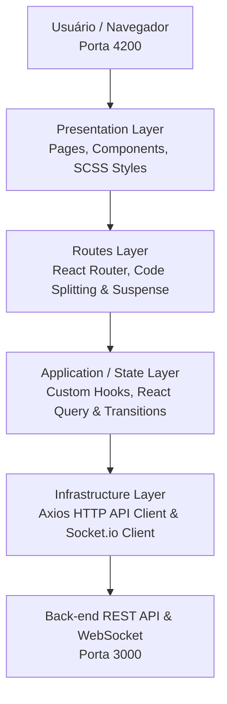

# NATIVE - Customer Management UI

Interface Web Front-end desenvolvida em React 19 com TypeScript, Vite e SCSS, estruturada sob os princípios de **Clean Architecture**, **Componentização Reutilizável** e **Design System Customizado** para a gestão de clientes e atendimento da Native IP.

## 🛠️ Stack Tecnológica

- **Core:** React 19 + TypeScript

- **Build Tool / Bundler:** Vite (Porta `4200`)

- **UI Framework / Design System:** Material Design (MUI v6) com centralização de componentes e ícones em `src/components/common/mui`

- **Estilização & Temas:** SCSS (Sass) centralizado em `src/assets/styles/_variables.scss` (suporte nativo a Dark/Light mode via atributos `[data-theme]`) + Emotion

- **Roteamento:** React Router DOM (v7) com Code Splitting (`React.lazy` + `Suspense`)

- **Comunicação Real-time:** Socket.io-client

- **Testes Unitários:** Vitest

- **Qualidade de Código & Linting:** ESLint v9 + Prettier

- **Runtime & Package Manager:** Node.js v26.5.0 via `npm`

## 🏗️ Arquitetura do Front-end

A aplicação adota uma Clean Architecture no Front-end, separando responsabilidades em camadas bem definidas e desacoplando os componentes visuais dos serviços de infraestrutura e estado:



### 🎨 Design System & UX Engine

- **Suporte Semântico de Temas:** Alternância dinâmica entre Light/Dark Mode gerida por atributos `[data-theme]` no documento HTML e sincronização do Favicon.

- **Transições Fluídas de Rota:** Gerenciamento concorrente com `useTransition` do React no `MainLayout` para evitar renderizações síncronas em cascata e proporcionar transições de tela (_fade / slide_) suaves.

- **Menu Lateral Inteligente (Sidebar):** Recolhimento e colapso automático de submenus/grupos ativos ao alternar de rota ou expandir novas seções.

---

## 🌳 Estrutura de Pastas

<details>
<summary><b>📂 NATIVE.CustomerManagement.UI/</b></summary>

- 📁 **.github/** — Workflows de CI/CD (GitHub Actions)
- 📁 **.vscode/** — Configurações e extensões recomendadas
- 📁 **public/** — Ativos estáticos públicos (Favicon, SVG icons)
- 📁 **src/**
  - 📁 **api/** — Clientes de API REST (Axios) e instâncias de Socket.io
  - 📁 **assets/** — Recursos estáticos da aplicação
    - 📁 **illustrations/** — Ilustrações vetoriais (ex: página 404)
    - 📁 **images/** — Logos e favicons nos formatos dark/light (`logo-dark.png`, `logo-light.png`)
    - 📁 **styles/** — Estilos globais, mixins e o Design System (`_variables.scss` com variáveis semânticas de cores, gradientes e sombras)
  - 📁 **components/** — Componentes reutilizáveis de UI
    - 📁 **common/** — Componentes compartilhados (`BreadcrumbComponent`, `FooterComponent`, `HeaderComponent`, `SidebarComponent`, `LoadingComponent`)
      - 📁 **mui/** — Centralização de componentes e ícones do Material UI (`components.ts`, `icons.ts`)
    - 📁 **layout/** — Estrutura de layout principal da aplicação (`MainLayout`)
  - 📁 **hooks/** — Custom Hooks do React (`useAppTheme`, `useSidebarToggle`, `useFaviconTheme`)
  - 📁 **pages/** — Views/Páginas principais da aplicação (`Dashboard`, `Customers`, `CustomerDetails`, `NotFound`)
  - 📁 **providers/** — Provedores de contexto globais (`AppThemeProvider`, `FaviconThemeProvider`, `ThemeContextProvider`)
  - 📁 **routes/** — Configuração e proteção de rotas da aplicação (`AppRoutes`, `routeConfig.ts`, `loadWithDelay.ts`)
  - 📁 **types/** — Tipagens globais e contratos do domínio (`customer.ts`, `theme.ts`, `navigation.ts`)
  - 📁 **utils/** — Funções utilitárias e formatadores
  - 📁 **validators/** — Schemas de validação de formulários (Zod)
  - 📄 `App.tsx` — Componente Raiz da Aplicação
  - 📄 `main.tsx` — Ponto de entrada e renderização do React DOM
  - 📄 `vite-env.d.ts` — Tipagens do ambiente Vite
- 📄 `.editorconfig` — Padronização de formatação do editor
- 📄 `.env.example` — Modelo de variáveis de ambiente
- 📄 `.gitignore` — Arquivos ignorados pelo controle de versão
- 📄 `.nvmrc` — Versão padronizada do Node.js
- 📄 `.prettierrc` — Regras de formatação de código do Prettier
- 📄 `eslint.config.js` — Configuração do ESLint v9
- 📄 `index.html` — HTML principal e container da aplicação React
- 📄 `package-lock.json` — Registo de versões exatas das dependências npm
- 📄 `package.json` — Dependências e scripts do projeto
- 📄 `README.md` — Documentação da UI
- 📄 `tsconfig.json` — Configuração base do TypeScript
- 📄 `tsconfig.app.json` — Configuração TypeScript da aplicação React
- 📄 `tsconfig.node.json` — Configuração TypeScript do Vite/Node
- 📄 `vite.config.ts` — Configuração do bundler Vite (Porta 4200)

</details>

---

## 🚀 Pré-requisitos e Gestão de Versão (NVM & Node.js)

Para manter a consistência do ambiente entre todos os desenvolvedores e no pipeline de CI/CD, o projeto padroniza as versões do Node.js e do gestor de pacotes NPM.

- **Node.js**: `v26.5.0` (definido no arquivo `.nvmrc`)

- **NPM**: `v10.x` ou superior (gerenciado automaticamente pelo Node)

- **NVM (Node Version Manager)**: Recomendado para alternar a versão do Node facilmente.

### Como instalar o NVM:

`https://www.nvmnode.com/pt/guide/download.html`

### Como alternar para a versão correta do Node via NVM:

**Linux / macOS / WSL:**

```
nvm use

```

**Windows (`nvm-windows`):**

```
nvm use 26.5.0

```

## ⚙️ Configuração do Ambiente

1. **Clonar o repositório e acessar a pasta da UI:**

   ```
   git clone https://github.com/DiegoSantos18/NATIVE.CustomerManagement.UI.git
   cd NATIVE.CustomerManagement.UI

   ```

2. **Garantir a versão correta do Node.js:**

   ```
   nvm use

   ```

   _(No VS Code, pode pressionar `Ctrl + Shift + P` -> `Tasks: Run Task` -> `Usar versão do Node (.nvmrc)`)._

3. **Instalar as dependências do projeto:**

   ```
   npm install

   ```

4. **Configurar as Variáveis de Ambiente:**
   Copie o arquivo `.env.example` para criar o arquivo `.env` local:

   ```
   # Windows PowerShell
   if (!(Test-Path .env)) { Copy-Item .env.example .env }

   # Linux / Bash
   cp -n .env.example .env

   ```

   _(No VS Code, pode pressionar `Ctrl + Shift + P` -> `Tasks: Run Task` -> `Copiar .env.example para .env`)._

## 📜 Scripts Disponíveis

No arquivo `package.json`, estão configurados os seguintes scripts:

| Comando            | Descrição                                                             |
| ------------------ | --------------------------------------------------------------------- |
| `npm run dev`      | Inicia o servidor de desenvolvimento na porta `4200` com HMR do Vite. |
| `npm run build`    | Compila o TypeScript e gera o bundle minificado na pasta `dist/`.     |
| `npm run preview`  | Executa a versão de produção compilada localmente para verificação.   |
| `npm run test`     | Executa a suíte de testes unitários com o Vitest.                     |
| `npm run lint`     | Executa a verificação estática do código com ESLint.                  |
| `npm run lint:fix` | Corrige automaticamente problemas identificados pelo ESLint.          |
| `npm run format`   | Formata o código nos diretórios do projeto utilizando o Prettier.     |

## 🏃 Como Executar a Aplicação

### Modo Desenvolvimento

Para subir o front-end localmente conectando à API:

```
npm run dev

```

O front-end estará acessível em: `http://localhost:4200`

## 🌐 Mapeamento de Portas do Ecossistema

| Serviço                 | URL                     | Descrição              |
| ----------------------- | ----------------------- | ---------------------- |
| **Front-end (UI)**      | `http://localhost:4200` | Aplicação React + Vite |
| **Back-end (API REST)** | `http://localhost:3000` | API Express / Node.js  |
| **WebSocket**           | `http://localhost:3000` | Servidor Socket.io     |
