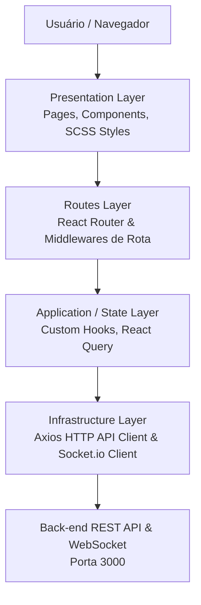

# NATIVE - Customer Management UI

Interface Web Front-end desenvolvida em React com TypeScript, Vite e SCSS, estruturada sob os princípios de **Clean Architecture** e **Componentização Reutilizável** para a gestão de clientes e atendimento em tempo real da Native IP.

---

## 🛠️ Stack Tecnológica

- **Core:** React 19 + TypeScript
- **Build Tool / Bundler:** Vite (Porta `4200`)
- **UI Framework / Design System:** Material Design (MUI v6)
- **Estilização:** SCSS (Sass) + Emotion (para componentes MUI)
- **Roteamento:** React Router DOM (v7)
- **Comunicação Real-time:** Socket.io-client
- **Qualidade de Código & Linting:** ESLint v9 + Prettier
- **Runtime & Package Manager:** Node.js v26.5.0 via `npm`

---

## 🏗️ Arquitetura do Front-end

A aplicação adota uma Clean Architecture no Front-end, separando responsabilidades em camadas bem definidas e desacoplando os componentes visuais dos serviços de infraestrutura e estado:



---

## 📂 Estrutura de Pastas

```text
NATIVE.CustomerManagement.UI/
├── .github/                      # Workflows de CI/CD (GitHub Actions)
├── .vscode/                      # Configurações, Tasks e Extensões recomendadas
├── public/                       # Ativos estáticos públicos (Favicon, SVG icons)
├── src/
│   ├── api/                      # Clientes de API REST (Axios) e instâncias de Socket.io
│   ├── assets/                   # Imagens, vetores e fontes estáticas
│   ├── components/               # Componentes reutilizáveis de UI (Design System)
│   ├── hooks/                    # Custom Hooks do React
│   ├── pages/                    # Views/Páginas principais da aplicação
│   ├── routes/                   # Configuração e proteção de rotas da aplicação
│   ├── styles/                   # Estilos globais, temas, variáveis e mixins SCSS
│   ├── utils/                    # Funções utilitárias e formatadores
│   ├── validators/               # Schemas de validação de formulários (Zod)
│   ├── App.scss                  # Estilos do componente principal
│   ├── App.tsx                   # Componente Raiz da Aplicação
│   ├── index.scss                # Estilos e resets globais
│   ├── main.tsx                  # Ponto de entrada e renderização do React DOM
│   └── vite-env.d.ts             # Tipagens do ambiente Vite
├── .editorconfig                 # Padronização do editor
├── .env.example                  # Modelo de variáveis de ambiente
├── .gitignore                    # Arquivos ignorados pelo Git
├── .nvmrc                        # Versão padronizada do Node.js (26.5.0)
├── .prettierrc                   # Regras de formatação de código do Prettier
├── eslint.config.js              # Configuração do ESLint v9
├── index.html                    # HTML principal e container da aplicação React
├── package.json                  # Dependências e scripts do projeto
├── README.md                     # Documentação da UI
├── tsconfig.json                 # Configuração base do TypeScript
├── tsconfig.app.json             # Configuração TypeScript da aplicação React
├── tsconfig.node.json            # Configuração TypeScript do Vite/Node
└── vite.config.ts                # Configuração do bundler Vite (Porta 4200)
```

---

## 🚀 Pré-requisitos e Gestão de Versão (NVM & Node.js)

Para manter a consistência do ambiente entre todos os desenvolvedores e no pipeline de CI/CD, o projeto padroniza as versões do Node.js e do gerenciador de pacotes NPM.

- **Node.js**: `v26.5.0` (definido no arquivo `.nvmrc`)
- **NPM**: `v10.x` ou superior (gerenciado automaticamente pelo Node)
- **NVM (Node Version Manager)**: Recomendado para alternar a versão do Node facilmente.

### Como instalar o NVM:

`https://www.nvmnode.com/pt/guide/download.html`

### Como alternar para a versão correta do Node via NVM:

**Linux / macOS / WSL:**

```bash
nvm use
```

**Windows (`nvm-windows`):**

```cmd
nvm use 26.5.0
```

---

## ⚙️ Configuração do Ambiente

1. **Clonar o repositório e acessar a pasta da UI:**

   ```bash
   git clone https://github.com/DiegoSantos18/NATIVE.CustomerManagement.UI.git
   cd NATIVE.CustomerManagement.UI
   ```

2. **Garantir a versão correta do Node.js:**

   ```bash
   nvm use
   ```

   _(No VS Code, você pode pressionar `Ctrl + Shift + P` -> `Tasks: Run Task` -> `Usar versão do Node (.nvmrc)`)._

3. **Instalar as dependências do projeto:**

   ```bash
   npm install
   ```

4. **Configurar as Variáveis de Ambiente:**
   Copie o arquivo `.env.example` para criar o arquivo `.env` local:
   ```bash
   # Windows PowerShell
   if (!(Test-Path .env)) { Copy-Item .env.example .env }

   # Linux / Bash
   cp -n .env.example .env
   ```
   _(No VS Code, você pode pressionar `Ctrl + Shift + P` -> `Tasks: Run Task` -> `Copiar .env.example para .env`)._

---

## 📜 Scripts Disponíveis

No arquivo `package.json`, estão configurados os seguintes scripts:

| Comando            | Descrição                                                             |
| :----------------- | :-------------------------------------------------------------------- |
| `npm run dev`      | Inicia o servidor de desenvolvimento na porta `4200` com HMR do Vite. |
| `npm run build`    | Compila o TypeScript e gera o bundle minificado na pasta `dist/`.     |
| `npm run preview`  | Executa a versão de produção compilada localmente para verificação.   |
| `npm run lint`     | Executa a verificação estática do código com ESLint.                  |
| `npm run lint:fix` | Corrige automaticamente problemas identificados pelo ESLint.          |
| `npm run format`   | Formata o código nos diretórios do projeto utilizando o Prettier.     |

---

## 🏃 Como Executar a Aplicação

### Modo Desenvolvimento

Para subir o front-end localmente conectando à API:

```bash
npm run dev
```

O front-end estará acessível em: `http://localhost:4200`

---

## 🌐 Mapeamento de Portas do Ecossistema

| Serviço                 | URL                     | Descrição              |
| ----------------------- | ----------------------- | ---------------------- |
| **Front-end (UI)**      | `http://localhost:4200` | Aplicação React + Vite |
| **Back-end (API REST)** | `http://localhost:3000` | API Express / Node.js  |
| **WebSocket**           | `http://localhost:3000` | Servidor Socket.io     |
