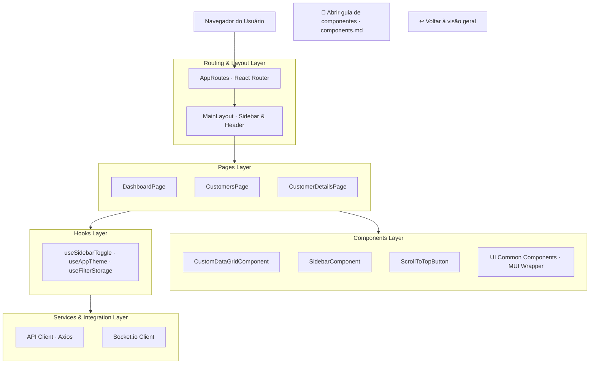

# 📐 Arquitetura da UI

[← Voltar ao README / visão geral](../README.md) · [🧩 Guia de componentes e design system](./components.md#componentes-principais)

---

## 🏗️ Organização Modular e Camadas

O front-end adota o padrão de Clean Architecture adaptado ao ecossistema React, desacoplando a camada de apresentação visual dos hooks de estado, serviços de integração e provedores contextuais.

[🧩 Abrir diretamente o guia de componentes e design system](./components.md#componentes-principais)

---

## 🔄 Fluxos de Navegação e Transição Concunrent

1. **AppRoutes & Lazy Loading:** As páginas são carregadas dinamicamente via `React.lazy` e `Suspense`. O roteador aciona o reset automático de scroll para o topo a cada alteração de pathname.
2. **MainLayout & Concorrência:** O `MainLayout` utiliza o `useTransition` do React para gerenciar transições suaves sem congelar a interface enquanto componentes pesados ou dados estão sendo processados.
3. **ScrollToTopButton:** Atua como um serviço duplo dentro do layout — garantindo o scroll to top automático de rota e renderizando o botão flutuante posicionado acima do rodapé em rolagens verticais.

---

## 🌳 Estrutura de Pastas

Abaixo está a estrutura exata de arquivos e diretórios que compõem o repositório da UI:

<b>📂 NATIVE.CustomerManagement.UI/</b>

- 📁 **`.github/`** — Workflows de CI/CD (GitHub Actions)
- 📁 **`.vscode/`** — Configurações e extensões recomendadas
- 📁 **`docs/`** — Documentação complementar e capturas de tela
  - 📁 **`assets/`** — Imagens da interface (`devices_preview.png`, `dashboard_preview1.png`, etc.)
  - 📄 `architecture.md` — Arquitetura modular e estrutura de pastas
  - 📄 `components.md` — Guia do Design System, Data Grid e galeria de telas
- 📁 **`public/`** — Ativos estáticos públicos (`favicon.png`)
- 📁 **`src/`** — Código-fonte da aplicação React
  - 📁 **`api/`** — Clientes HTTP Axios e conectores WebSocket por módulo
    - 📁 `common/` — Instância base e interceptores
    - 📁 `customers/` — Endpoints de clientes
  - 📁 **`assets/`** — Ilustrações, logos e temas SCSS
    - 📁 `illustrations/` — SVGs da página 404 e estados vazios
    - 📁 `images/` — Logotipos `logo-dark.png` e `logo-light.png`
    - 📁 `styles/` — Estilos globais e variáveis de design system (`_variables.scss`)
  - 📁 **`components/`** — Componentes reutilizáveis de interface
    - 📁 `common/` — Cabeçalho, rodapé, barra lateral, breadcrumbs e wrappers MUI (`mui/`)
    - 📁 `layout/` — Estrutura de layout de páginas (`MainLayout`)
  - 📁 **`hooks/`** — Custom Hooks segregados por módulo
    - 📁 `filters/` — Persistência e gerenciamento de filtros
    - 📁 `notifications/` — Feedback visual e toasts
    - 📁 `sidebar/` — Controle de colapso do menu lateral
    - 📁 `theme/` — Alternância e sincronização de temas
  - 📁 **`pages/`** — Views principais da aplicação (`common/`, `customers/`, `dashboard/`)
  - 📁 **`providers/`** — Provedores de contexto globais (`theme/`, `notifications/`)
  - 📁 **`routes/`** — Definição de rotas, lazy loading e transições (`AppRoutes.tsx`)
  - 📁 **`utils/`** — Funções utilitárias e formatadores
  - 📁 **`validators/`** — Schemas Zod para formulários
  - 📄 `App.tsx` — Componente raiz
  - 📄 `main.tsx` — Entry point da aplicação React DOM
- 📄 `.editorconfig` — Padronização de formatação de código
- 📄 `.env.example` — Modelo de variáveis de ambiente
- 📄 `.nvmrc` — Versão padronizada do Node.js (`v26.5.0`)
- 📄 `.prettierrc` — Regras do Prettier
- 📄 `eslint.config.js` — Configuração do ESLint v9
- 📄 `index.html` — HTML principal da aplicação
- 📄 `package.json` — Dependências e scripts
- 📄 `tsconfig.json` — Configuração TypeScript
- 📄 `vite.config.ts` — Configuração do Vite (Porta `4200`)

---

## 🔗 Documentação relacionada

- [README — visão geral e guia de inicialização](../README.md)
- [Guia de componentes — design system e galeria](./components.md#componentes-principais)
