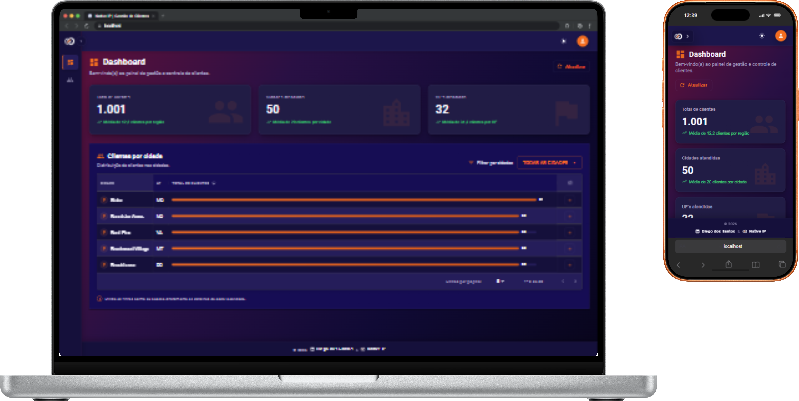
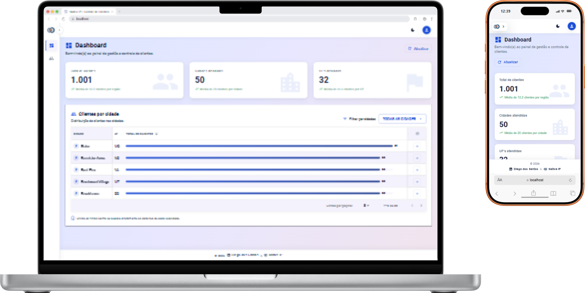
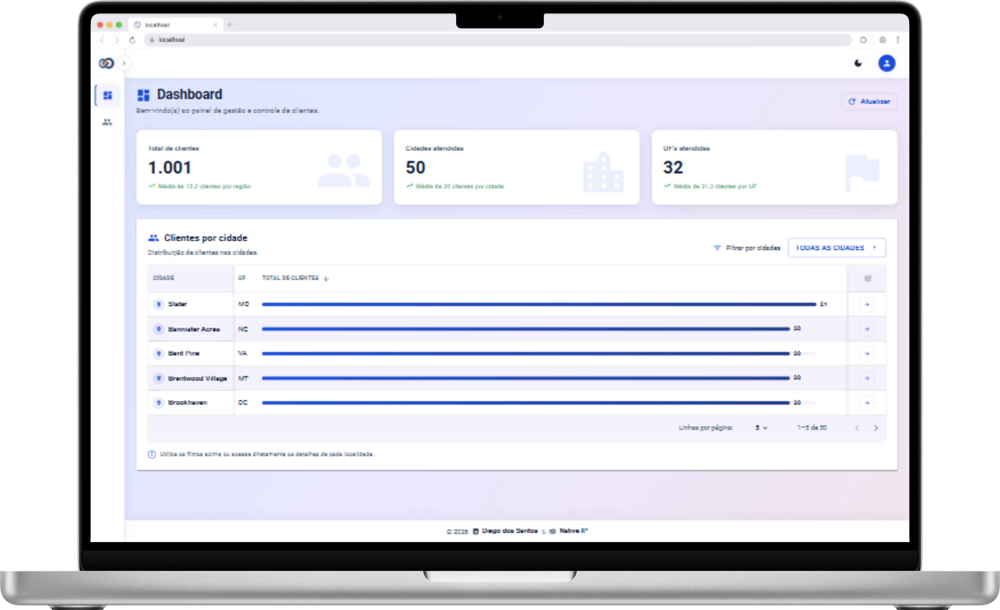
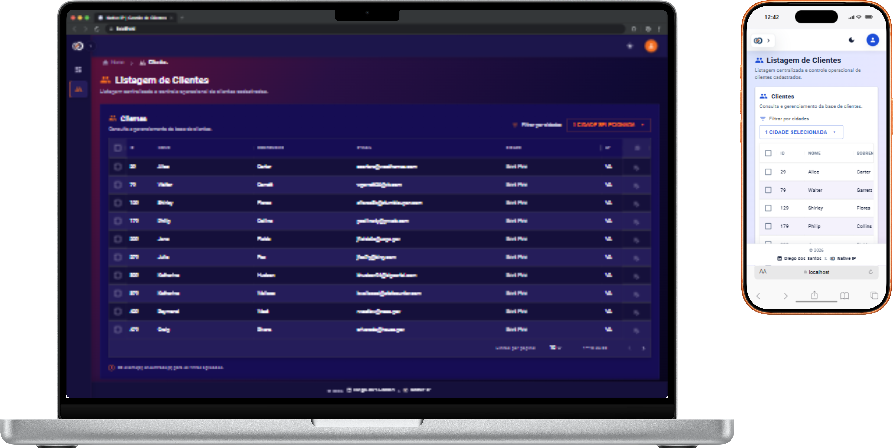
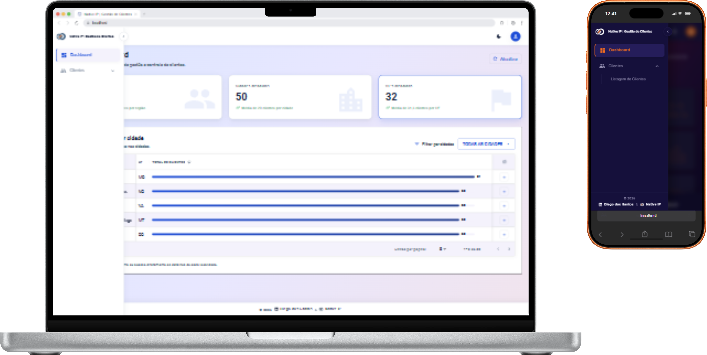

# 🧩 Guia de Componentes e Design System

Este documento detalha o Design System, os componentes compartilhados de UI e apresenta a galeria completa de capturas de tela da aplicação **Native Customer Management UI**.

[← Voltar ao README / visão geral](../README.md) · [📐 Arquitetura modular](./architecture.md)

---

## 🎨 Design System e Temas

O projeto adota uma arquitetura de estilos fundamentada em variáveis SCSS centralizadas em `src/assets/styles/_variables.scss`, aplicando o conceito de **Tokens de Design Semânticos**:

- **Fundo Principal (Dark):** Tom azul marinho corporativo profundo (`#0B0D1B` / `#10142D`).
- **Fundo Principal (Light):** Superfície clara limpa e de alto contraste.
- **Cor de Destaque / Brand:** Laranja vibrante (`var(--primary)`) utilizado em ações primárias, hover states e indicadores.
- **Suporte Dinâmico:** Alternância nativa via atributo `[data-theme="dark"]` e `[data-theme="light"]` no elemento raiz HTML.

---

## 🧩 Componentes Principais

### 1. `ScrollToTopButton`

Componente utilitário integrado ao `MainLayout` que cumpre dois papéis fundamentais de UX:

- **Resolução Automática em Rotas:** Ao navegar para uma nova página, aciona suavemente `window.scrollTo({ top: 0, left: 0, behavior: 'smooth' })`.
- **Botão Flutuante Seguro:** Exibe um botão circular discreto posicionado com margem de segurança no canto inferior direito (`bottom: 32px`, `right: 24px`) assim que a rolagem vertical ultrapassa 250px.

### 2. `CustomDataGridComponent`

Tabela otimizada desenvolvida sobre o Material UI para a gestão de dados operacionais:

- **Linhas Alternadas Opacas:** Previne vazamentos visuais de fundo em estados de seleção ou passagem do cursor (_hover_).
- **Colunas Sticky Responsivas:** As colunas fixadas desativam a propriedade _sticky_ automaticamente em dispositivos móveis (`< 769px`) para evitar quebra de layout.
- **Persistência de Filtros:** Estado dos filtros mantido dinamicamente na sessão via `useFilterStorage`.

### 3. `SidebarComponent`

Menu de navegação lateral responsivo e colapsável:

- **Transição Concorrente:** Utiliza `useTransition` do React para evitar atrasos de renderização ao expandir subgrupos de menu.
- **Auto-Colapso:** Recolhe automaticamente seções inativas ao navegar entre rotas principais.

---

## 🖼️ Galeria de Telas

Abaixo estão centralizadas as capturas de tela oficiais da interface da aplicação em diferentes contextos e dispositivos.

### 1. Visão Multi-dispositivo Completa

> Exibição simultânea da aplicação adaptada para Desktop, Tablet e Mobile em Light Mode e Dark Mode.
> 

---

### 2. Painel Gerencial (Dashboard - Modo Escuro)

> Indicadores de clientes, cidades e UFs atendidas com gráficos em tema Dark.
> 

---

### 3. Painel Gerencial (Dashboard - Modo Claro)

> Visão limpa do painel administrativo com suporte nativo ao tema Light.
> 

---

### 4. Visão Desktop Ampliada (Full Dashboard)

> Dashboard em tela cheia destacando a distribuição de clientes por localidade.
> 

---

### 5. Listagem de Clientes e Data Grid (Desktop & Mobile)

> Tabela interativa de clientes com paginação, filtros por cidade e visualização responsiva mobile.
> 

---

### 6. Menu Lateral & Navegação Responsiva

> Menu colapsável em tema claro no desktop e gaveta de navegação deslizante no smartphone.
> 

---

[← Voltar ao README / visão geral](../README.md) · [📐 Arquitetura modular](./architecture.md)
